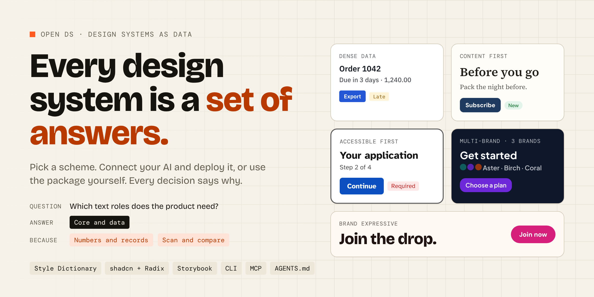

# Open DS

<p align="center">
  
</p>

## Start here

Open DS models a design system as a grammar of questions. A scheme answers every question with a reason, and deploys as a whole design system: tokens, components, Storybook, docs and an agent layer.

- **The guide** for Open DS itself (product, business, brand, CLI, MCP, agents, contributing): [guide/intro.md](guide/intro.md)
- **Run it locally**, end to end, including the CLI and the MCP server: [TESTING.md](TESTING.md)
- **The schemes and the grammar**: [schemes/](schemes/)
- **The docs of a delivered design system** (Docusaurus, one scheme at a time): `docs/`, see TESTING.md

The sections below describe the first preview (packs and recipes). Its commands still run.

## The first preview

Open DS is a cited dictionary of design-system decisions. `open-ds init` turns a stance recipe into files a person or an agent can start from.

The display name is the `name` field in [brand.json](brand.json).

**Choose your design system on purpose.**

Think of it as a recipe book.

- A **pack** is a chapter. Purpose, color, type, space, and radius are chapters.
- A **scheme** is one question in that chapter, with allowed answers.
- A **recipe** is the set of answers you picked, each with its source or 'Your pick'.
- A **boilerplate** is a starter someone wrote so the recipe can be used. The book does not cook the dish.

Open DS does not calculate colors or tokens. A calculation scheme is stored as data: a name, a plain description, a formula reference, parameters, sources, and trade-offs. Token files in a boilerplate use the DTCG format.

The license file is MIT until the owner decides.

## Three ways to read the book

| Surface    | Who it is for | What it does                                           |
| ---------- | ------------- | ------------------------------------------------------ |
| Packs      | Everyone      | The dictionary. JSON only.                             |
| MCP server | An AI agent   | Lists questions and checks a recipe. It runs no model. |
| Website    | A person      | Browse the catalog, pick answers, and see the check.   |

There is also a validator, and a local CLI that copies a boilerplate onto your machine. The CLI package name `open-ds` is a placeholder. It is not published.

## Prerequisites

- Node.js 22 (`engines` asks for `>=22`. CI uses 22.)
- pnpm 10.33.4
- Python 3.12 (`requires-python` is `>=3.11`. CI uses 3.12.)
- uv 0.12.15

## Clone, install, and run

```bash
git clone https://github.com/3dyonic/Open-DS.git
cd Open-DS
pnpm install
uv sync --all-packages
node cli/bin/open-ds.js init recipes/dense-data.json --out ./my-ds
```

`uv sync` on its own does not install the validator. Init then fails with `Failed to spawn: open-ds-validate`. Use `uv sync --all-packages`.

The same init works for `recipes/accessible-first.json`, `recipes/multi-brand.json`, `recipes/content-first.json`, and `recipes/brand-expressive.json`.

`./my-ds` is the bundle:

| File                | What it is for                                                               |
| ------------------- | ---------------------------------------------------------------------------- |
| `recipe.json`       | The answers in the recipe. Stance recipes include `"status": "provisional"`. |
| `theme/tokens.json` | DTCG tokens. Each value carries `$extensions.openDs`.                        |
| `links.json`        | One row per pack link: id, from, to, type, basis, and sources.               |
| `AGENTS.md`         | Rules for an agent. The first line is the recipe status.                     |

The folder also contains the shared boilerplate (CSS, components, and `open-ds.json`).

Check the install:

```bash
node cli/bin/open-ds.js check --dir ./my-ds
```

Committed examples for all five presets:

```bash
bash examples/run-preset.sh dense-data
bash examples/run-preset.sh --all
```

Each `examples/<stance>/` folder holds `recipe.json`, `tokens.json`, `links.json`, and `AGENTS.md`. The stances are `accessible-first`, `dense-data`, `multi-brand`, `content-first`, and `brand-expressive`. CI regenerates all five and fails if any file differs.

## Website

`pnpm --dir site dev` starts the site and keeps running, so it holds this terminal. Use a second terminal for anything else. CI does not start the dev server.

```bash
pnpm --dir site dev
```

## Other commands

**Validator** (after `uv sync --all-packages`):

```bash
uv run open-ds-validator check recipes/3dyonic.json
uv run open-ds-validate recipes/3dyonic.json
```

**MCP**

```bash
uv run open-ds-mcp
```

Add `--http` for a local streamable HTTP server on port 8765.

`add` and `diff` print a clear message. They do not change files in this preview.

## The 3dyonic recipe

`recipes/3dyonic.json` is a provisional example. `boilerplates/3dyonic/` is the starter written to follow it: DTCG tokens, CSS variables for light and dark, a Tailwind preset, and Button, Input, Card, and Badge. Structure stays apart from theme. Components don't hard-code values. They read them from the theme.

## Checks

An error rejects the recipe. A warning or an info note does not reject it.

- A missing requirement is an error. The website blocks the build step.
- A discouraged pick is a warning.
- A recommendation does not raise a finding. A conditional recommendation prefills only when every `when` answer matches. If those answers are present but do not match, that option is discouraged instead. One answer of an AND list does nothing.
- Floors on the global pack always apply: contrast, resize, text spacing, and a 24px target. Payments, deletes and legal steps can be undone, checked or confirmed. A critical component hidden behind hover or an accordion is an error. Material's 48px target is a recommendation at every density. It does not replace the 24px floor.

Badges in the builder: **Fits your purpose**, **Worth a second look**, **Your purpose needs this**. The tooltip quotes the reason from its source. Picks with no source show 'Your pick', and floors show 'Always on, for accessibility'.
